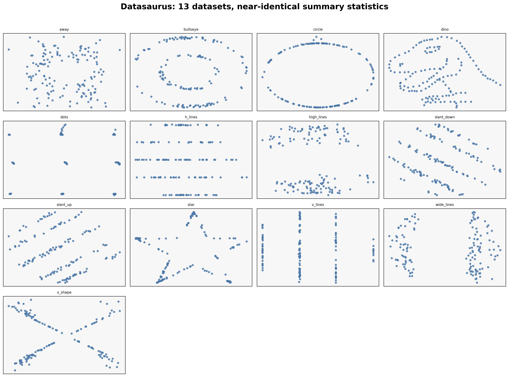
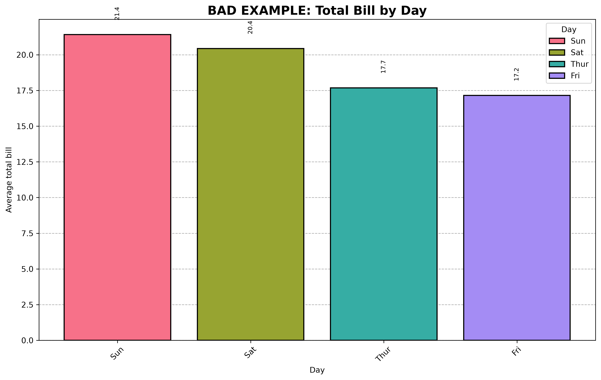
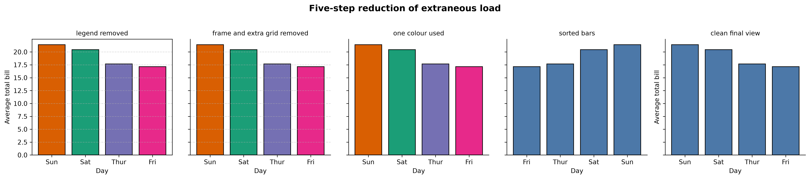
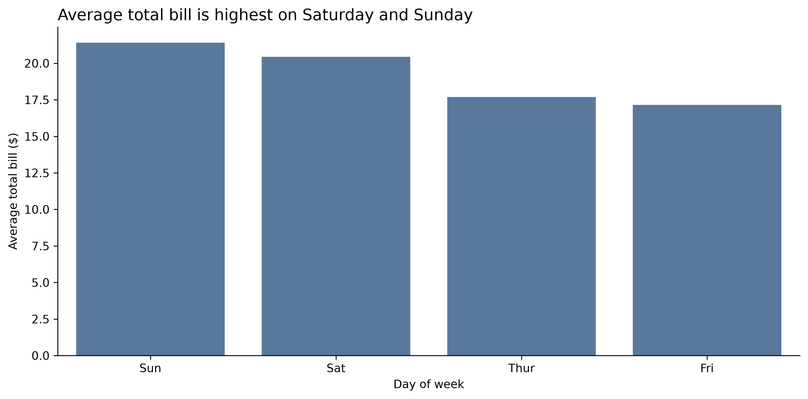
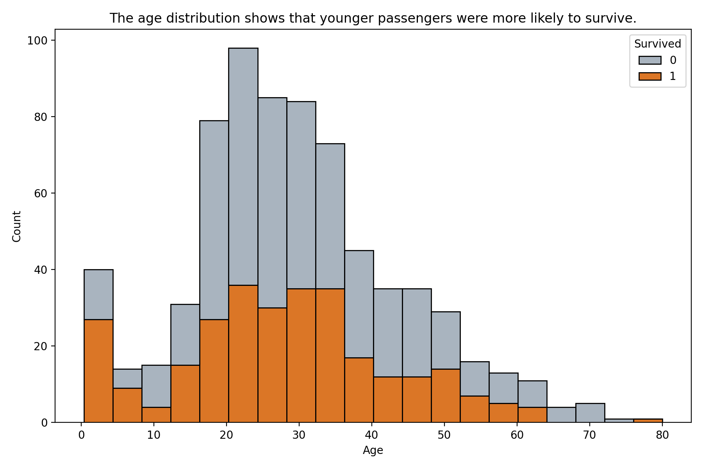
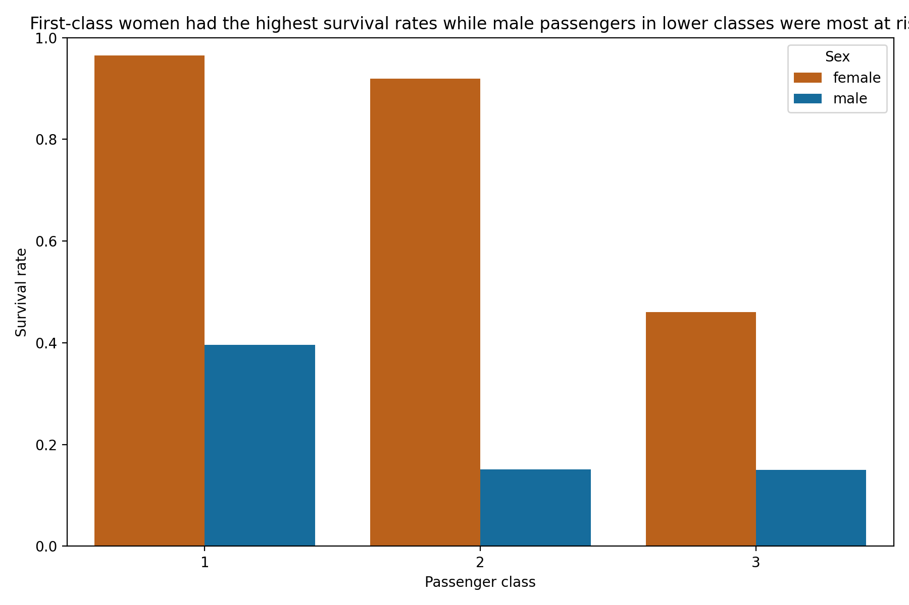
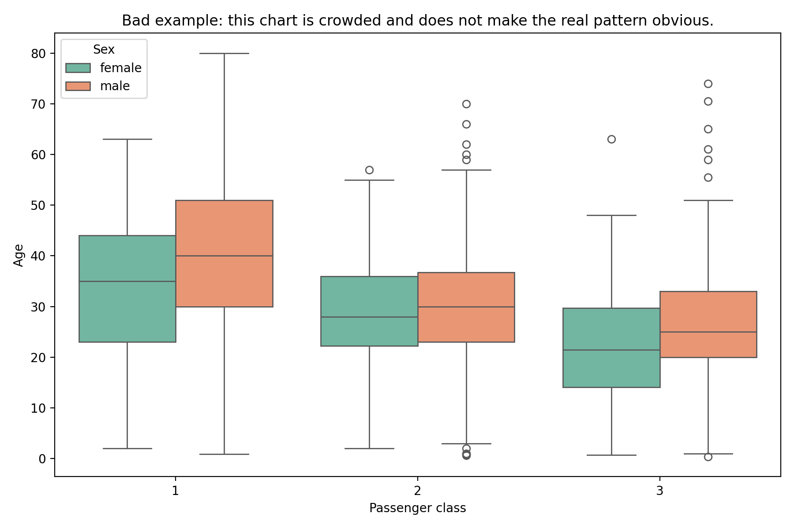
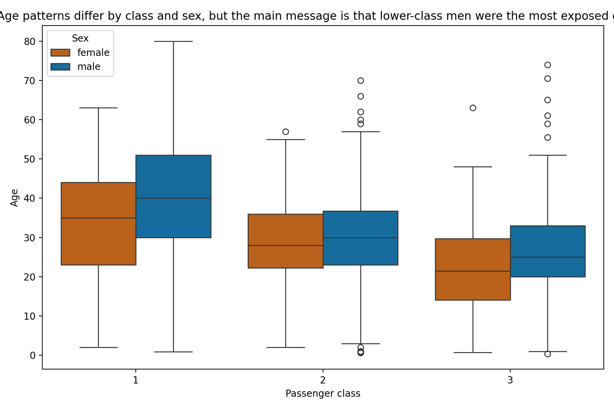
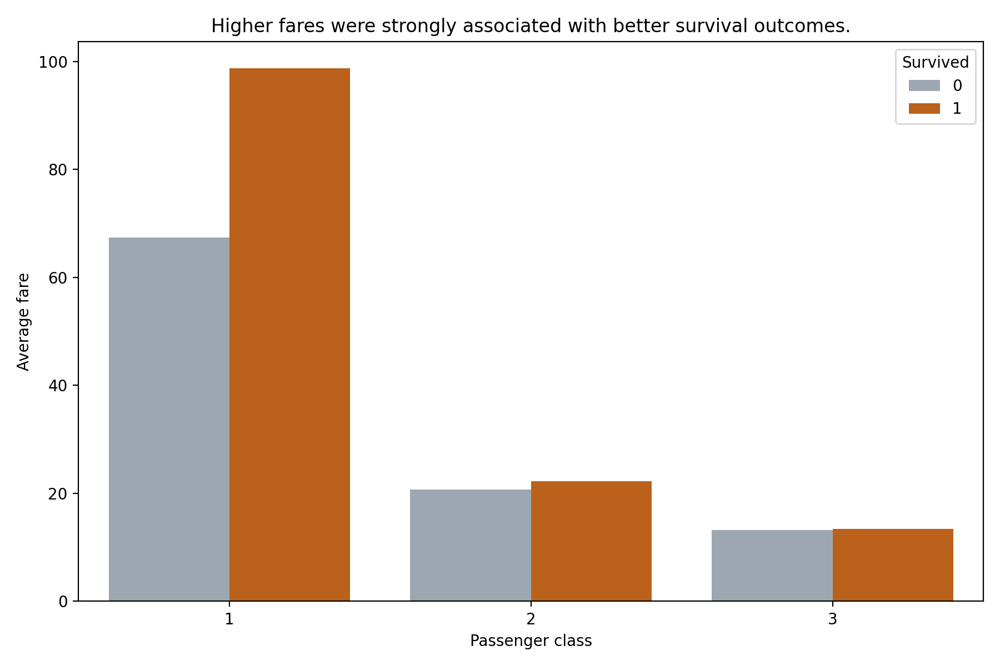

# M.MURSALEEN-BSAI-8A-004

This repository contains the complete weak-task work for the Data Visualization course, organized by week. The goal is to keep the work easy to follow for collaborators and to show the actual implementation clearly.

## Project overview

This repo includes three weak-task folders:

- week1/ — Week 1 work
- week2/ — Week 2 work
- week3/ — Week 3 work

Each week contains a Python implementation; generated chart outputs are currently available for Weeks 2 and 3.

## Folder structure

- week1/weak1.py — Week 1 solution
- week2/weak2.py — Week 2 solution
- week3/weak3.py — Week 3 solution
- week1/weak1.ipynb — notebook version for quick review
- week2/weak2.ipynb — notebook version for quick review
- week3/weak3.ipynb — notebook version for quick review
- data/ — shared or supporting datasets
- requirements.txt — Python dependencies

## Assignment coverage status

An audit against the included assignment briefs found that the current `weak1.py` and `weak2.py` files are focused examples, not complete implementations of the official assignments. They should not be described as fully compliant yet.

- Week 1's [assignment brief](week1/assignments/TASKS.md) requires five tasks using Datasaurus, Gapminder, penguins, MPG, and flights. The current `week1/weak1.py` only analyzes Titanic survival by class and sex.
- Week 2's [assignment brief](week2/assignments/TASKS.md) requires five perception tasks, including real-participant experiments and charts built with the object-oriented Matplotlib API. The current `week2/weak2.py` contains two Titanic charts and does not cover those requirements.
- The [reference Week 3 brief](https://github.com/UsmarHaider/data-visualization/blob/main/week3/assignments/TASKS.md) now requires Parts A-E: nine chart rebuilds and diagnoses, a Lie Factor audit, palette testing, a clinical review figure, and a written justification. The current `week3/weak3.py` is a three-chart Titanic demo and does not implement those parts.
- The three weak-task notebooks currently have no saved cell outputs. Week 2's brief explicitly requires notebooks submitted with outputs.
- The images under `week1/charts/` are lecture reference charts, not outputs generated by `week1/weak1.py`. That script is configured to save its own charts under `week1/outputs/`, but those outputs are not present yet.

## Week 1

File: week1/weak1.py

The current script is a focused Titanic example. It:

- loads the Titanic dataset
- drops rows with key missing values and reports how many were removed
- compares survival rate by passenger class
- compares survival rate by sex
- is configured to save two charts in the week1/outputs folder

This does not complete the five-task Week 1 assignment listed in `week1/assignments/TASKS.md`.

## Week 2

File: week2/weak2.py

This task focuses on visual perception and readable design. The script:

- loads the Titanic dataset
- handles missing data transparently
- shows the age distribution by survival outcome
- compares survival rate by passenger class and sex
- saves the chart outputs clearly for review

This matches the core Week 2 idea of reducing clutter and making the chart message obvious.

## Week 3

File: week3/weak3.py

This task focuses on a cleaner and more honest story with the same dataset. The script:

- loads the Titanic dataset
- reports missing values before plotting
- shows a deliberately crowded version
- provides a cleaner redesign
- plots a mechanism chart comparing fare and survival outcome

This matches the Week 3 objective of building well-structured, honest, readable visualizations.

## Collaborator output gallery

This section embeds the available results and links to their source files. The `weak_one` and `weak_two` images are the main weak-task outputs; the `week1` charts are lecture references, and `week2`/`week3` contain additional Titanic demos.

### Weak One — Datasaurus output

- Script: [weak_one/weak_one.py](weak_one/weak_one.py)
- Statistics table: [weak_one/outputs/weak_one_summary_table.csv](weak_one/outputs/weak_one_summary_table.csv)



### Weak Two — Cognitive-load outputs

- Script: [weak_two/weak_two.py](weak_two/weak_two.py)
- Written explanation: [weak_two/weak_two_report.md](weak_two/weak_two_report.md)







### Week 1 lecture reference charts

These are lecture visuals, not outputs from the current `weak1.py` task script.

- Notebook: [week1/weak1.ipynb](week1/weak1.ipynb)
- Script: [week1/weak1.py](week1/weak1.py)


### Week 2 Titanic demo outputs

- Notebook: [week2/weak2.ipynb](week2/weak2.ipynb)
- Script: [week2/weak2.py](week2/weak2.py)





### Week 3 Titanic demo outputs

- Notebook: [week3/weak3.ipynb](week3/weak3.ipynb)
- Script: [week3/weak3.py](week3/weak3.py)







For a dedicated gallery page, see [COLLABORATOR_OUTPUTS.md](COLLABORATOR_OUTPUTS.md).

## How to run

From the project root:

```bash
python -m venv .venv
.venv\Scripts\activate
pip install -r requirements.txt
python week1\weak1.py
python week2\weak2.py
python week3\weak3.py
```

If you are using a Windows environment with a blocked default Python, use a clean project virtual environment instead of the system interpreter.

## Collaborator note

This README is meant to make the project easy to review. Anyone opening the repo can quickly understand:

- what each weak is about
- which file contains the actual work
- how the work is connected to the assignment instructions
- how to run and inspect the outputs

This file is the short access summary for collaborators and the actual work remains in the week folders.
