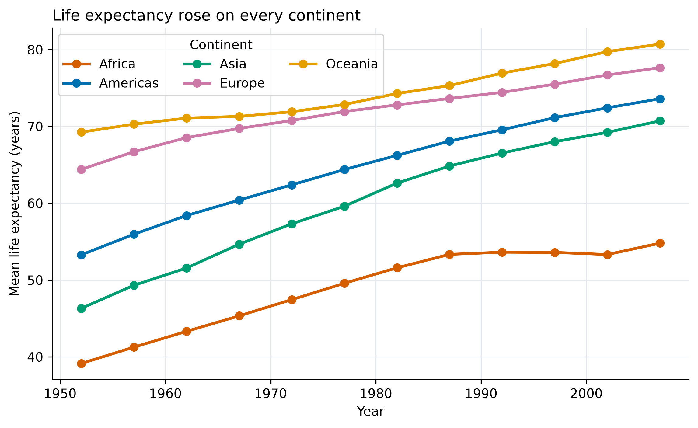
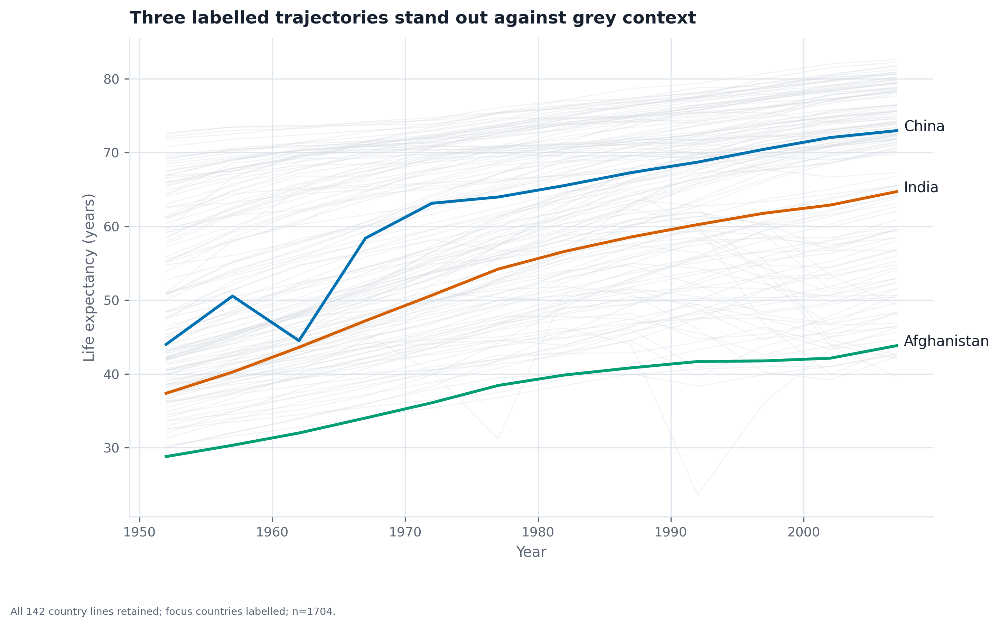
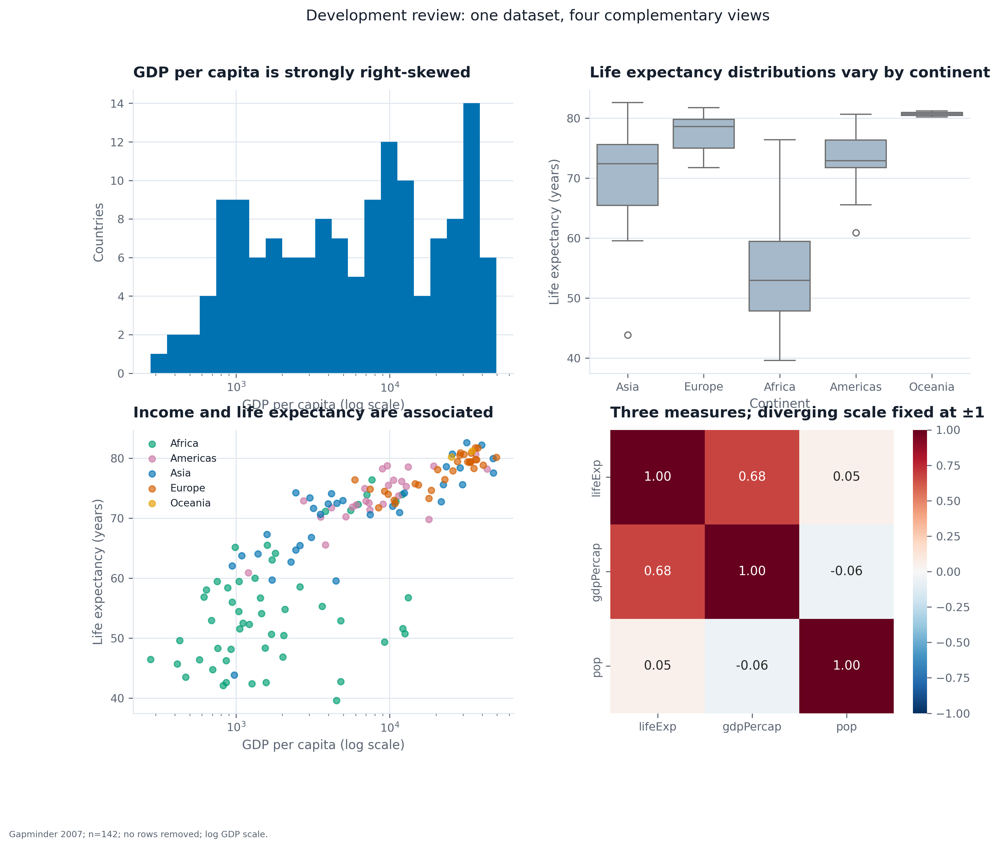
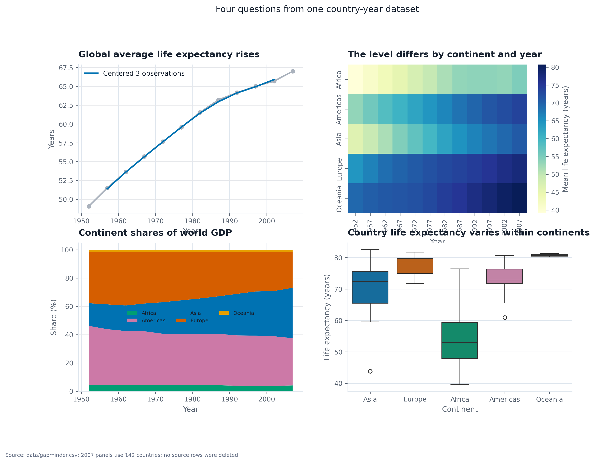
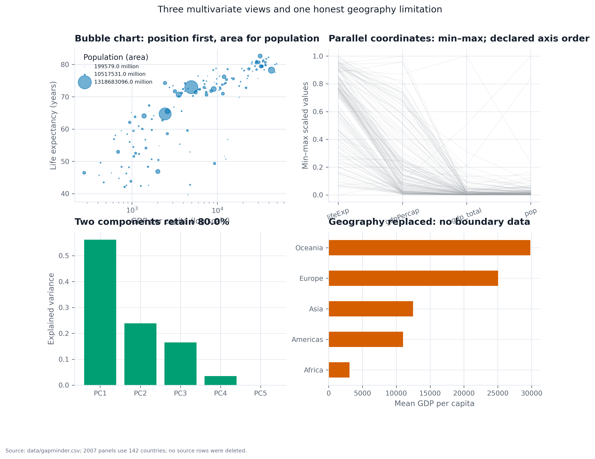
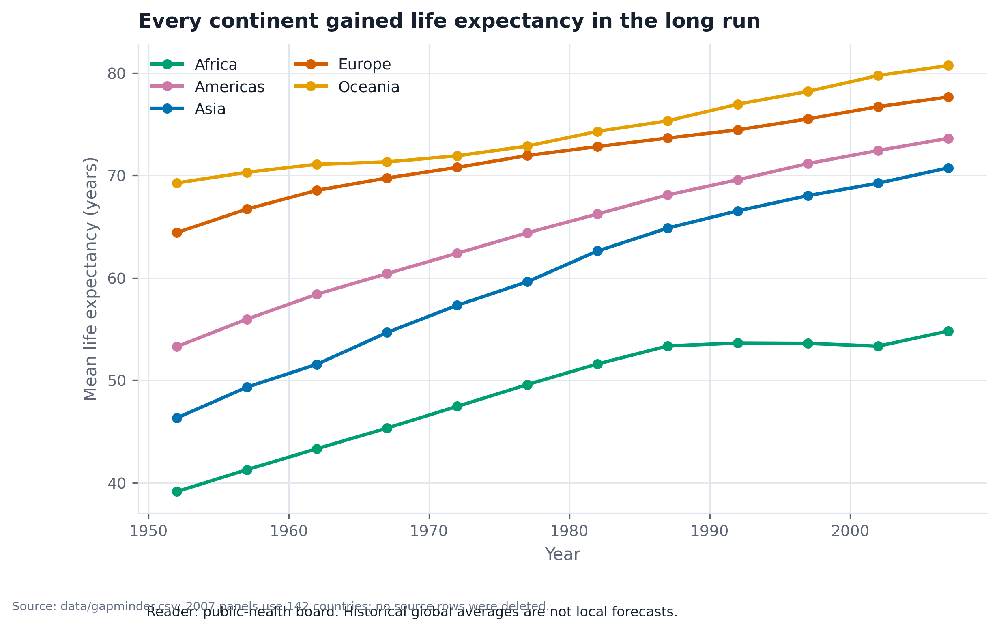

# Data Visualization Coursework

**Student:** M. Mursaleen<br>
**Class:** BSAI 8A<br>
**Roll/ID:** 004

## Dataset

All six weekly folders use exactly one source dataset: [`data/gapminder.csv`](data/gapminder.csv). It has 1,704 country-year rows for 142 countries, five continents, and 12 years from 1952 to 2007. It is included with the instructor's public [data-visualization course repository](https://github.com/UsmarHaider/data-visualization). I kept one copy because the time, category, population, life-expectancy, and GDP fields support many charting skills without adding conflicting datasets.

The original briefs use different datasets. Each notebook marks where its task was adapted. Geography-specific tasks cannot produce honest maps without coordinates or boundaries, and human-reader experiments are left pending until real readers participate. No participant results or instructor-dataset defects are invented.

## Weekly solutions

| Week folder | Task name | Topic | Link to notebook |
|---|---|---|---|
| [weak-1](weak-1/) | Task 1 — Prove why we visualize | Summary statistics and country variation | [Notebook](weak-1/weak-1_solution.ipynb) |
| [weak-1](weak-1/) | Task 2 — Trends and the spaghetti problem | Time-series aggregation and highlighting | [Notebook](weak-1/weak-1_solution.ipynb) |
| [weak-1](weak-1/) | Task 3 — Distributions and relationships | Distributions and grouped associations | [Notebook](weak-1/weak-1_solution.ipynb) |
| [weak-1](weak-1/) | Task 4 — Pick the right chart | Five question-led chart choices and redesign | [Notebook](weak-1/weak-1_solution.ipynb) |
| [weak-1](weak-1/) | Task 5 — A real time series | Trend and repeated observations | [Notebook](weak-1/weak-1_solution.ipynb) |
| [weak-2](weak-2/) | Task 1 — Preattentive attributes | Visual search and pop-out | [Notebook](weak-2/weak-2_solution.ipynb) |
| [weak-2](weak-2/) | Task 2 — Gestalt principles | Grouping, connection, and proximity | [Notebook](weak-2/weak-2_solution.ipynb) |
| [weak-2](weak-2/) | Task 3 — Cognitive load | Decluttering, data-ink, and chunking | [Notebook](weak-2/weak-2_solution.ipynb) |
| [weak-2](weak-2/) | Task 4 — Channel effectiveness | Position, length, and area comparisons | [Notebook](weak-2/weak-2_solution.ipynb) |
| [weak-2](weak-2/) | Task 5 — Capstone redesign | Perception audit and one-message redesign | [Notebook](weak-2/weak-2_solution.ipynb) |
| [weak-3](weak-3/) | Part A — Nine chart diagnoses | Encoding, scales, bins, and honest redesigns | [Notebook](weak-3/weak-3_solution.ipynb) |
| [weak-3](weak-3/) | Part B — Lie Factor | Measured chart distortion | [Notebook](weak-3/weak-3_solution.ipynb) |
| [weak-3](weak-3/) | Part C — Palette check | Colour-vision simulation | [Notebook](weak-3/weak-3_solution.ipynb) |
| [weak-3](weak-3/) | Part D — Review figure | Four-panel statistical review | [Notebook](weak-3/weak-3_solution.ipynb) |
| [weak-3](weak-3/) | Part E — Written justification | Parameters, exclusions, and trade-offs | [Notebook](weak-3/weak-3_solution.ipynb) |
| [weak-4](weak-4/) | Part A — Nine temporal/composition cases | Date order, aggregation, smoothing, shares | [Notebook](weak-4/weak-4_solution.ipynb) |
| [weak-4](weak-4/) | Part B — Window sensitivity | Rolling windows and slope direction | [Notebook](weak-4/weak-4_solution.ipynb) |
| [weak-4](weak-4/) | Part C — Part-to-whole legality | Exclusive shares, pie and bar comparison | [Notebook](weak-4/weak-4_solution.ipynb) |
| [weak-4](weak-4/) | Part D — Review figure | Four-panel time and composition dashboard | [Notebook](weak-4/weak-4_solution.ipynb) |
| [weak-4](weak-4/) | Part E — Written justification | Window and aggregation choices | [Notebook](weak-4/weak-4_solution.ipynb) |
| [weak-4](weak-4/) | Part F — Bonus cycle plot | Limits of the available time resolution | [Notebook](weak-4/weak-4_solution.ipynb) |
| [weak-5](weak-5/) | Part A — Nine multivariate diagnoses | Bubble size, scaling, axes, aggregation, radar | [Notebook](weak-5/weak-5_solution.ipynb) |
| [weak-5](weak-5/) | Part B — Channel and spatial decisions | Overplotting, PCA, and geography limits | [Notebook](weak-5/weak-5_solution.ipynb) |
| [weak-5](weak-5/) | Part C — Two-map activity | Categorical comparison; real-reader results pending | [Notebook](weak-5/weak-5_solution.ipynb) |
| [weak-5](weak-5/) | Part D — Three multivariate figures | Bubble plot and parallel coordinates | [Notebook](weak-5/weak-5_solution.ipynb) |
| [weak-5](weak-5/) | Part E — Written justification | Channels, scaling, and missing geometry | [Notebook](weak-5/weak-5_solution.ipynb) |
| [weak-5](weak-5/) | Part F — Bonus normalized map | Not possible without a second spatial dataset | [Notebook](weak-5/weak-5_solution.ipynb) |
| [weak-6](weak-6/) | Task A — Data audit | Keys, missingness, sentinels, and ranges | [Notebook](weak-6/weak-6_solution.ipynb) |
| [weak-6](weak-6/) | Task B — Three chart questions | Trend, composition, and relationship | [Notebook](weak-6/weak-6_solution.ipynb) |
| [weak-6](weak-6/) | Task C — Board figure | Life-expectancy trend for a named audience | [Notebook](weak-6/weak-6_solution.ipynb) |
| [weak-6](weak-6/) | Task D — Bonus interaction | Filterable, hoverable local HTML chart | [Notebook](weak-6/weak-6_solution.ipynb) |

## Key charts

### weak-1



### weak-2



### weak-3



### weak-4



### weak-5



### weak-6



## Run

```powershell
python -m pip install -r requirements.txt
python coursework\weekly_coursework.py
```

Then open any `weak-N\weak-N_solution.ipynb` notebook in Jupyter. Each notebook runs its week's figures and displays its saved outputs. The interactive Week 6 bonus is `weak-6\charts\week6_interactive.html`.

The earlier integrated portfolio notebook remains at [`coursework/coursework.ipynb`](coursework/coursework.ipynb), and the reusable Week 1–3 generation code is in [`coursework/solutions.py`](coursework/solutions.py).
