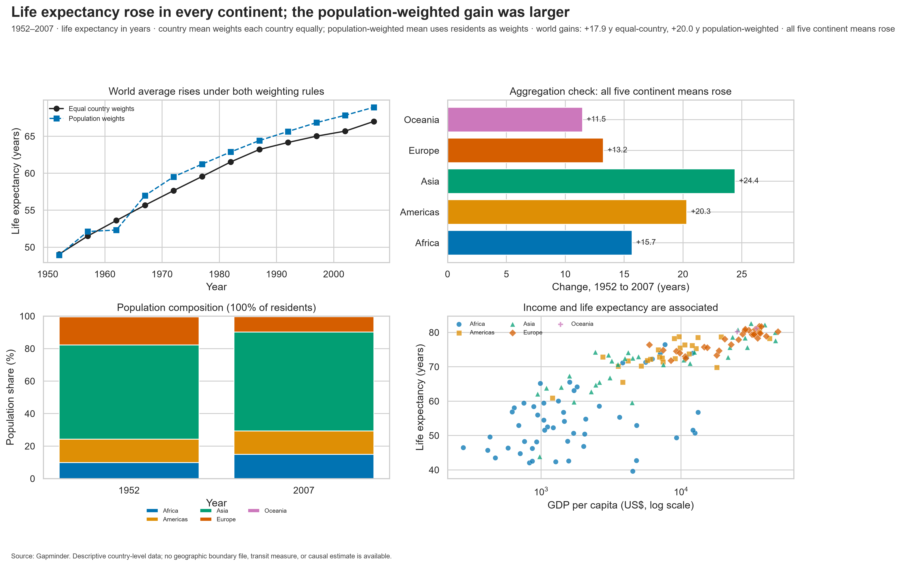

# Week 7 — Integrated visual analysis

This Week 7 adaptation uses only the repository's existing `data/gapminder.csv`; it adds no dataset and does not alter Weeks 1–6. The instructor's exact transit-data cleaning, map, and reversal tasks cannot be completed honestly from Gapminder, which has no transit returns or geographic boundaries.

From the repository root, run `python weak-7\week7_solution.py`. The script audits the source, prints and saves `partA_audit.txt`, then writes four 300-dpi charts, the interactive view's default PNG, and the four-panel dashboard under `weak-7\charts\`. Use `python weak-7\week7_solution.py --interactive` to open the continent filter and Reset control.

The charts cover a time trend, population composition, income/life-expectancy relationship, and 2007 country-level distribution. The dashboard shows that all five continent means rose from 1952 to 2007; it does not claim the transit-specific Simpson reversal. Task-specific decisions and limitations are documented in `partA_decisions.md`, `partC_contract.md`, and `partE_note.md`.

Dependencies are already listed in the repository-root `requirements.txt` (pandas, NumPy, Matplotlib, and Seaborn). No new package is required. Human-reader bonus testing was not performed.
